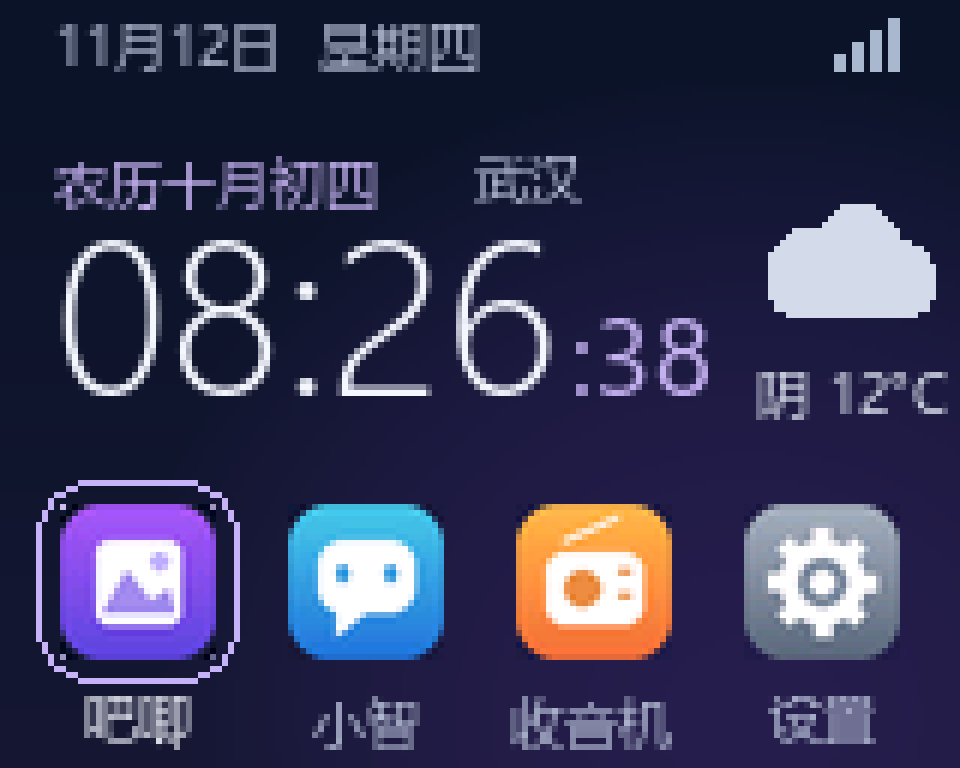

# AlphaPi One S Desktop

<p align="center"></p>

<p align="center">电子吧唧 · 小智语音 · 网络收音机 · 手机设置</p>

> 图为桌面布局预览，日期、时间和天气为示例。

适用于 AlphaPi One S 的四功能桌面：电子吧唧、小智语音助手、网络收音机、手机设置。桌面显示日期、星期、农历、时间秒数和天气；小智采用白底动态表情页。

## 适用设备

| 项目 | 本版本适配规格 |
|---|---|
| 开发板 | AlphaPi One S，本项目实测板 |
| 主控 | ESP32-S2R2，实测芯片 revision 1.0 |
| Flash / PSRAM | 8 MB Flash / 2 MB PSRAM |
| 屏幕 | ST7735，物理 128×160，横屏使用 160×128 |
| 音频 | N32 UART 协处理器，460800 baud，24 kHz、8 位无符号单声道 |
| 按键 | 前置 A/B/C/D 四键 |
| 无线 | 2.4 GHz Wi-Fi；ESP32-S2 不支持蓝牙 |
| 电池 | 可使用板载电池供电；本固件不支持电量、充电状态读取 |

**不适用于 AlphaPi One（ESP32-S3）、ESP32-C3 或其他 GPIO 不同的开发板。** 同名或不同硬件版本的 One S，刷写前需要核对下表。

| 接口 | GPIO |
|---|---|
| 屏幕 SCK / MOSI / MISO | 37 / 38 / 45 |
| 屏幕 CS / DC / RESET / 背光 | 34 / 36 / 35 / 33 |
| 音频 UART1 TX / RX | 3 / 0 |
| A / B / C / D | 13 / 12 / 11 / 10（高电平有效） |

## 操作

- C/D：左右选择图标，收音机内切台。
- A：进入、确认；小智开始/结束对话；收音机播放/暂停。
- B：返回桌面。退出小智或收音机后等待相关任务释放，再启动另一功能。
- 长按 C 增加音量，长按 D 降低音量。
- 设置或吧唧页面开启热点：`AlphaPi-Desk`，默认密码 `alphapi88`，手机浏览器打开 `http://192.168.4.1`。
- 手机网页支持选择图片、裁切并上传，设置 Wi-Fi 和天气地区。只支持 2.4 GHz Wi-Fi。
- 小智首次使用需按页面验证码在服务平台绑定；网络和服务端可用性会影响对话。

公开版不包含作者的 Wi-Fi 名称、密码、设备 NVS 或小智绑定资料，首次使用需配网。默认热点密码是公开的，建议只在配置期间使用。

## 编译

实测环境：ESP-IDF 6.0.1，目标 esp32s2。使用 ESP-IDF 环境终端，在源码根目录执行：

```sh
idf.py -B build -D IDF_TARGET=esp32s2 -D "SDKCONFIG_DEFAULTS=previous.defaults;ones.defaults" build
```

本版本在 main/CMakeLists.txt 中固定选择 alphapi-one-s-desktop 板目录；不要直接用上游多板构建脚本切换型号。首次编译需要网络下载依赖。保留 dependencies.lock 以固定依赖版本。

## 刷机

安装 esptool 4.5.1，确认串口。保持 USB 连接，关电源，按住 BOOT 开机，等两秒松开。Windows 使用附带的 flash.cmd 并输入串口；也可按 firmware/flash_args.txt 的地址刷写。

写入完成后松开所有按键，用电源开关关机 3–5 秒再开机。设备有电池，只拔 USB 不一定会重启。重刷应用通常会保留原来的配网和绑定信息；请勿将个人 NVS 转储上传到 GitHub。

## 实测与限制

在一块上述配置的 One S 上验证过显示、按键、手机页面、小智对话、收音机和双向切换；这不代表所有批次硬件都已验证。白底动态表情及单行 A/B 提示经实机确认。公开固件去掉预置 Wi-Fi 后重新编译，发布前应再做一次首次配网验证。

不包含电量显示、充电状态检测、蓝牙功能。服务器登录偶尔可能需要重试。屏幕空间有限，对话只显示当前可容纳的文字。

## 来源及许可证

- 小智基础工程：https://github.com/78/xiaozhi-esp32 ，保留原项目 LICENSE 和版权声明。
- AlphaPi 收音机与板级适配参考用户提供的 AlphaPi-Radio-2.3.2 source。其独立授权未在资料包中确认，见 THIRD_PARTY_NOTICES.md。
- components/desktop_transport 保留原来源代码和 LICENSE。

请保留仓库内各组件的许可证。不能仅因根目录有 MIT LICENSE，就将所有第三方资源统一声明为 MIT。上游说明保留在 README.upstream.md。
